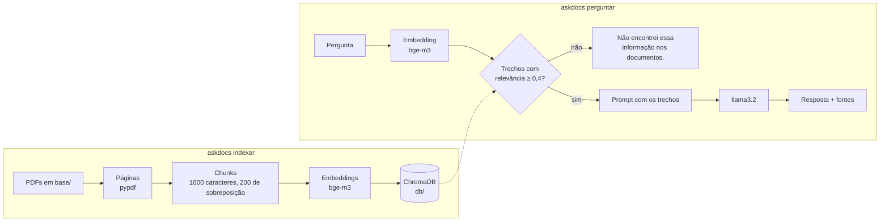

# AskDocs

Assistente de IA que responde perguntas sobre os seus PDFs usando **RAG**
(Retrieval-Augmented Generation), rodando **100% local**: Ollama para os
modelos, ChromaDB para o banco vetorial e LangChain para ligar as peças.
Seus documentos nunca saem da sua máquina e nenhuma chave de API é necessária.

```text
$ askdocs perguntar "Qual o limite de hospedagem por noite em viagem?"
R$ 380,00 por noite.

Fontes:
  - manual-do-colaborador-nebula-labs.pdf (p. 5)
```

## Como funciona



1. **Indexar**: cada página dos PDFs é dividida em trechos (chunks) que se
   sobrepõem, para que uma regra cortada ao meio continue inteira em pelo menos
   um deles. Cada trecho vira um vetor (embedding) e é gravado no Chroma.
2. **Perguntar**: a pergunta vira um vetor e é comparada com a base. Só os
   trechos acima do limiar de relevância seguem para o modelo, junto com a
   instrução de responder **apenas** com base neles e citar a fonte.

Se nenhum trecho for relevante, o AskDocs responde que não encontrou a
informação **sem chamar o modelo**: não inventa resposta e não gasta CPU.

## Requisitos

- [uv](https://docs.astral.sh/uv/) (instala o Python 3.12 do projeto sozinho)
- [Ollama](https://ollama.com/download) aberto, com os modelos:

```bash
ollama pull bge-m3
```

```bash
ollama pull llama3.2
```

## Instalação

```bash
git clone https://github.com/LucasEstrela-FullStack/Askdocs.git
cd Askdocs
uv sync
cp .env.example .env   # opcional: só para mudar os padrões
```

## Uso

Coloque seus PDFs em `base/` (subpastas também são lidas). Para testar sem
documentos próprios, gere o manual fictício de exemplo:

```bash
uv run scripts/gerar_pdf_exemplo.py
```

Crie (ou recrie) o banco vetorial. Rode de novo sempre que mudar os PDFs:

```bash
uv run askdocs indexar
```

Faça uma pergunta direta:

```bash
uv run askdocs perguntar "Com quantos dias de antecedência devo pedir férias?"
```

Ou abra o modo conversa (Enter vazio ou `sair` encerra):

```bash
uv run askdocs perguntar
```

## Configuração

Tudo é configurável por variáveis de ambiente ou pelo arquivo `.env`
(veja [.env.example](.env.example)).

| Variável | Padrão | Para que serve |
|---|---|---|
| `ASKDOCS_PASTA_BASE` | `base` | Pasta com os PDFs |
| `ASKDOCS_PASTA_DB` | `db` | Onde o Chroma grava o banco vetorial |
| `ASKDOCS_COLECAO` | `askdocs` | Nome da coleção no Chroma |
| `ASKDOCS_OLLAMA_URL` | `http://localhost:11434` | Endereço do Ollama |
| `ASKDOCS_OLLAMA_NUM_GPU` | *(vazio)* | Camadas na GPU; vazio deixa o Ollama decidir, `0` força CPU |
| `ASKDOCS_MODELO_EMBEDDING` | `bge-m3` | Modelo de embeddings (multilíngue, bom em português) |
| `ASKDOCS_MODELO_CHAT` | `llama3.2` | Modelo que escreve a resposta |
| `ASKDOCS_TEMPERATURA` | `0.1` | Criatividade do modelo (baixa = mais fiel aos trechos) |
| `ASKDOCS_TAMANHO_CHUNK` | `1000` | Tamanho máximo de cada trecho, em caracteres |
| `ASKDOCS_SOBREPOSICAO_CHUNK` | `200` | Caracteres repetidos entre trechos vizinhos |
| `ASKDOCS_K` | `4` | Quantos trechos buscar por pergunta |
| `ASKDOCS_LIMIAR_RELEVANCIA` | `0.4` | Relevância mínima (0 a 1) para um trecho ser usado |

Trocou o modelo de embedding ou o tamanho dos chunks? Rode `askdocs indexar`
de novo: a base antiga foi gerada com os parâmetros anteriores.

Para respostas melhores, troque o modelo de chat por um maior, por exemplo
`ollama pull qwen2.5:7b` e `ASKDOCS_MODELO_CHAT=qwen2.5:7b`. Fica mais lento na CPU.

## Testes

```bash
uv run pytest
```

Os testes unitários usam embeddings falsos e não precisam do Ollama. Os testes
de integração geram o PDF de exemplo, indexam e fazem perguntas reais ao
Ollama (levam alguns minutos na CPU):

```bash
uv run pytest -m integracao
```

## Estrutura

```text
src/askdocs/
├── config.py     # parâmetros do RAG lidos do ambiente/.env
├── ingestao.py   # PDFs → páginas → chunks
├── banco.py      # embeddings no Ollama + persistência no Chroma
├── consulta.py   # busca por similaridade com limiar de relevância
├── prompt.py     # prompt restrito aos trechos recuperados
├── cli.py        # comandos askdocs indexar / perguntar
└── erros.py      # erros mostrados ao usuário sem traceback
scripts/gerar_pdf_exemplo.py   # manual fictício para testar a base
tests/                         # unitários + integração (-m integracao)
```

## Problemas comuns

| Sintoma | Causa e solução |
|---|---|
| `erro: Ollama nao respondeu` | O Ollama não está aberto. Inicie o app ou rode `ollama serve`. |
| `erro: Modelo '...' nao instalado` | Rode o `ollama pull` indicado na mensagem. |
| `llama-server process has terminated: exit status 0xc0000005` | A GPU (comum em placas antigas com Vulkan) derruba o Ollama. Use `ASKDOCS_OLLAMA_NUM_GPU=0` no `.env`. |
| `aviso: ... nao tem texto extraivel` | PDF escaneado (imagem). Ele precisa passar por OCR antes. |
| `aviso: Ignorando ...` | PDF protegido por senha ou corrompido; os demais são indexados normalmente. |
| Responde "Não encontrei" para algo que está no PDF | Reduza `ASKDOCS_LIMIAR_RELEVANCIA` (ex.: `0.3`) ou aumente `ASKDOCS_K`. |

## Créditos

Construído seguindo o passo a passo
[desta aula sobre RAG com LangChain e Python](https://www.youtube.com/watch?v=0M8iO5ykY-E),
trocando a OpenAI por modelos locais no Ollama.
