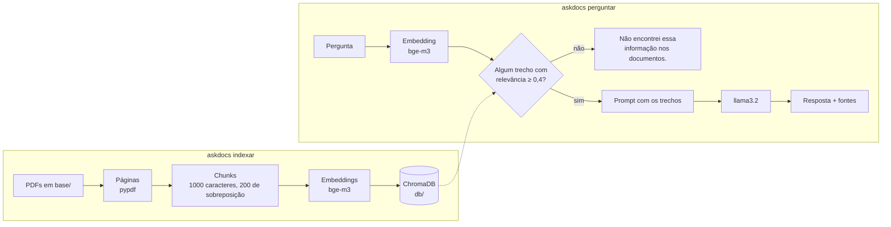

# AskDocs

Faz perguntas aos seus PDFs pelo terminal e responde com base no que está
escrito neles, citando arquivo e página. Usa RAG (Retrieval-Augmented
Generation) com Ollama, ChromaDB e LangChain, tudo rodando na sua máquina:
não precisa de chave de API e os documentos não vão para lugar nenhum.

```text
$ askdocs perguntar "Qual o limite de hospedagem por noite em viagem?"
R$ 380,00 por noite.

Fontes:
  - manual-do-colaborador-nebula-labs.pdf (p. 3, 5)
```

## Como funciona



Na indexação, cada página vira trechos (chunks) de até 1000 caracteres. Um
trecho repete o fim do anterior, para que uma regra cortada ao meio apareça
inteira em pelo menos um deles. Cada trecho vira um vetor e vai para o Chroma.

Na pergunta, o texto também vira um vetor e é comparado com a base. Os trechos
mais parecidos vão para o modelo junto com uma instrução: responder só com o
que está ali. Se nenhum trecho passa do limiar de relevância, o AskDocs já
responde que não encontrou e o modelo nem é chamado, o que na CPU poupa uns
40 segundos.

Rodar `indexar` de novo só calcula embeddings do que mudou. Trechos iguais
ficam como estão, e os de PDFs apagados ou editados saem da base.

## Requisitos

- [uv](https://docs.astral.sh/uv/), que baixa sozinho o Python 3.12 do projeto
- [Ollama](https://ollama.com/download) aberto, com os dois modelos:

```bash
ollama pull bge-m3
```

```bash
ollama pull llama3.2
```

## Instalação

```bash
git clone https://github.com/LucasEstrela-FullStack/Askdocs.git
cd Askdocs
uv sync
cp .env.example .env   # opcional, só se for mudar algum padrão
```

## Uso

Coloque os PDFs em `base/` (subpastas também contam). Se ainda não tiver
nenhum, gere o manual de exemplo, de uma empresa inventada:

```bash
uv run scripts/gerar_pdf_exemplo.py
```

Monte a base. Rode de novo sempre que adicionar, trocar ou apagar PDFs:

```bash
uv run askdocs indexar
```

Pergunte direto:

```bash
uv run askdocs perguntar "Com quantos dias de antecedência devo pedir férias?"
```

Ou abra o modo conversa (Enter vazio ou `sair` encerra):

```bash
uv run askdocs perguntar
```

## Configuração

Dá para mudar tudo por variável de ambiente ou no `.env`
(o modelo está em [.env.example](.env.example)).

| Variável | Padrão | O que faz |
|---|---|---|
| `ASKDOCS_PASTA_BASE` | `base` | Pasta dos PDFs |
| `ASKDOCS_PASTA_DB` | `db` | Onde o Chroma guarda a base |
| `ASKDOCS_COLECAO` | `askdocs` | Nome da coleção no Chroma |
| `ASKDOCS_OLLAMA_URL` | `http://localhost:11434` | Endereço do Ollama |
| `ASKDOCS_OLLAMA_NUM_GPU` | *(vazio)* | Camadas na GPU. Vazio deixa o Ollama decidir; `0` usa só a CPU |
| `ASKDOCS_OLLAMA_KEEP_ALIVE` | `1800` | Segundos que o modelo fica carregado depois da última pergunta |
| `ASKDOCS_MODELO_EMBEDDING` | `bge-m3` | Modelo dos embeddings (multilíngue, vai bem em português) |
| `ASKDOCS_MODELO_CHAT` | `llama3.2` | Modelo que escreve a resposta |
| `ASKDOCS_TEMPERATURA` | `0.1` | Quanto o modelo pode variar. Baixa deixa a resposta mais presa aos trechos |
| `ASKDOCS_TAMANHO_CHUNK` | `1000` | Tamanho máximo de cada trecho, em caracteres |
| `ASKDOCS_SOBREPOSICAO_CHUNK` | `200` | Caracteres que um trecho repete do anterior |
| `ASKDOCS_K` | `4` | Quantos trechos buscar por pergunta |
| `ASKDOCS_LIMIAR_RELEVANCIA` | `0.4` | Relevância mínima, de 0 a 1, para um trecho entrar na resposta |

Se trocar o modelo de embedding, rode `askdocs indexar`: a base é refeita do
zero, porque vetores de modelos diferentes não se comparam. Enquanto isso não
acontece, o `perguntar` avisa e não responde.

Quer respostas melhores? Troque o modelo de chat por um maior, como o
`qwen2.5:7b` (`ollama pull qwen2.5:7b` e `ASKDOCS_MODELO_CHAT=qwen2.5:7b`).
Na CPU ele fica mais lento.

## Privacidade

O AskDocs desliga o envio de rastros para o LangSmith mesmo que
`LANGSMITH_TRACING` esteja ligada no seu ambiente, e a telemetria do Chroma
também fica desligada. Se `ASKDOCS_OLLAMA_URL` apontar para outra máquina, ele
avisa: nesse caso as perguntas e os trechos dos PDFs saem do seu computador.

O texto dos PDFs é tratado como dado, não como instrução. Caracteres de
controle são removidos na leitura e na resposta, para que um PDF não consiga
mexer no seu terminal.

## Testes

```bash
uv run pytest
```

Os testes unitários usam embeddings falsos e rodam em poucos segundos, sem
Ollama. Os de integração geram o PDF de exemplo, indexam e fazem perguntas de
verdade ao Ollama. Na CPU levam uns três minutos:

```bash
uv run pytest -m integracao
```

## Estrutura

```text
src/askdocs/
├── config.py     # parâmetros lidos do ambiente e do .env
├── ingestao.py   # PDFs → páginas → chunks
├── banco.py      # embeddings e base no Chroma, com reindexação incremental
├── modelos.py    # conexão com o Ollama e garantia de execução local
├── consulta.py   # busca por similaridade com limiar de relevância
├── prompt.py     # prompt que limita a resposta aos trechos encontrados
├── texto.py      # remoção de caracteres de controle
├── cli.py        # comandos indexar e perguntar
└── erros.py      # erros mostrados sem traceback
scripts/gerar_pdf_exemplo.py   # gera o manual de exemplo
tests/                         # unitários e integração (-m integracao)
```

## Problemas comuns

| O que aparece | O que fazer |
|---|---|
| `erro: O Ollama não respondeu` | Abra o Ollama ou rode `ollama serve`. |
| `erro: O modelo '...' não está instalado` | Rode o `ollama pull` que a mensagem indica. |
| `llama-server process has terminated: exit status 0xc0000005` | A GPU derrubou o Ollama, o que é comum em placas antigas com Vulkan. Coloque `ASKDOCS_OLLAMA_NUM_GPU=0` no `.env`. |
| `erro: A base foi indexada com outro modelo de embedding` | Rode `askdocs indexar`. |
| `aviso: ... não tem texto para extrair` | O PDF é uma imagem escaneada e precisa passar por OCR antes. |
| `aviso: Ignorando ...` | PDF com senha ou corrompido. Os outros são indexados normalmente. |
| Responde "Não encontrei" para algo que está no PDF | Baixe `ASKDOCS_LIMIAR_RELEVANCIA` (por exemplo, `0.3`) ou aumente `ASKDOCS_K`. |

## Créditos

Feito a partir do passo a passo
[desta aula sobre RAG com LangChain e Python](https://www.youtube.com/watch?v=0M8iO5ykY-E),
trocando a OpenAI por modelos locais no Ollama.
